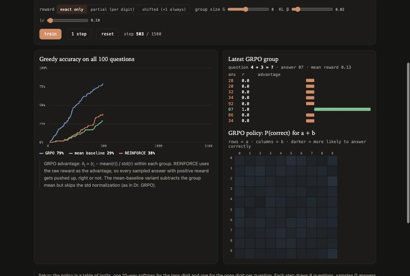

# GRPO Playground

**Live demo: https://mouryareddy5.github.io/grpo-playground/**

Watch Group Relative Policy Optimization (the RL method behind DeepSeek's reasoning models) teach a policy arithmetic, side by side with two baselines on identical data.



## The setup

- **Task:** answer `a + b = ?` for single digits a, b (100 questions), as a two-digit answer.
- **Policy:** a table of logits, with one 10-way softmax for the tens digit and one for the ones digit per question.
- **Each step:** draw 8 questions and sample a group of G answers for each, then run 2 clipped-ratio updates (ε = 0.2) with a k3 KL penalty to the starting policy.

## Three learners

| Learner | Advantage |
|---|---|
| GRPO | Aᵢ = (rᵢ − mean(r)) / std(r) within each group |
| Mean baseline (Dr. GRPO-style) | Aᵢ = rᵢ − mean(r) |
| REINFORCE | Aᵢ = rᵢ |

## Reward modes

- **Exact only:** 1 if the whole answer is right. Sparse.
- **Partial:** 0.5 per correct digit.
- **Shifted:** partial + 1 for every answer. Which answers are better doesn't change, but REINFORCE now pushes every sample up and slows down sharply. GRPO doesn't care about the shift.

Results at step 400 with defaults (exact reward, G = 8, lr 0.1): GRPO reaches about 69% greedy accuracy, against roughly 17–23% for the baselines.

## Visualisations

- Greedy accuracy curves for all three learners
- The latest GRPO group: each sampled answer, its reward and its advantage
- A 10×10 heatmap of P(correct answer) for every a + b

## Tech

Plain HTML, CSS and JavaScript. Gradients are derived analytically for the softmax policy, with no ML library. Hosted on GitHub Pages.

## Run locally

```bash
python3 -m http.server
```

Then open http://localhost:8000.

## References

- Shao et al., *DeepSeekMath* (2024), which introduced GRPO
- DeepSeek-AI, *DeepSeek-R1* (2025)
- Liu et al., *Understanding R1-Zero-Like Training: A Critical Perspective* (Dr. GRPO, 2025)
- Schulman et al., *Proximal Policy Optimization Algorithms* (2017)

Part of [Mourya Reddy's portfolio](https://mouryareddy5.github.io/).
